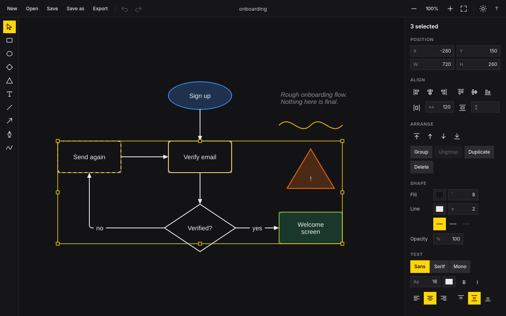

# Chalk



A simple whiteboard for diagrams and rough layouts. Draw boxes, connect them
with lines and arrows, type inside them, line them up, and export the result.
It is for sketching how something works or fits together, not for
high-fidelity design. On Omarchy, the interface follows your theme's accent
color, your window rounding, and your language.

Built with **Qt Quick (QML)** and the Material style over a C++ core. It
compiles to a single executable with the QML embedded in it.

## Drawing

- **An endless board.** Hold *Space* and drag to move around, *Ctrl+scroll*
  to zoom.
- **Shapes**: rectangle, ellipse, diamond, triangle. Pick a tool and drag, or
  click to drop one under the pointer.
- **Text in shapes.** Double-click a shape and type. Double-click bare board
  to type loose text. Text takes a font, size, color, bold and italic, and
  aligns left, center or right and top, middle or bottom inside its shape.
- **Connectors.** With the line or arrow tool, drag from one shape to
  another. The line holds on to both and follows them when they move. Drop an
  end near the middle of a side to pin it there; anywhere else it floats to
  whichever side faces the other end. Lines run straight, elbowed or curved,
  take an arrowhead at either end, and a label (double-click the line).
- **Pen and pencil.** The pen puts down a path point by point: click for a
  corner, drag for a curve, *Enter* to finish, click the first point to close
  the shape. The pencil draws freehand and smooths the stroke.
- **Reshaping a path.** Double-click a path to edit its points: drag points
  and curve handles, double-click a point to switch it between corner and
  curve, double-click the line to add a point, *Delete* to remove one. Hold
  *Alt* while dragging a handle to break a smooth point into a cusp.
- **Selecting.** Click, *Shift*-click to add, or drag a box around things.
  Drag any handle to resize, several things at once included; *Shift* keeps
  the proportions.
- **Copying by dragging.** Hold *Ctrl* and drag something to carry off a
  copy, leaving the original where it was.
- **Snapping.** A move catches on the edges and middles of what's nearby,
  and on gaps: if two things in a row sit 20 apart, a third catches at 20
  from either of them, and halfway between two that have room. The matching
  gaps are marked with their size. A resize catches the same way: the edge
  being dragged stops on the edges and middles of its neighbours. Hold *Alt*
  to move or resize freely.
- **Distances.** While something is being moved or resized near other
  things, the gap to its nearest neighbour on each side is measured out
  beside it, in board units.
- **By mouse.** Everything has a button or a menu entry. The bar along the
  top holds files, undo and redo, zoom, and light or dark; right-click the
  board for cut, copy, paste, duplicate, group, order and align.
- **Lining up.** With two or more things selected: align left, center,
  right, top, middle or bottom; space them out evenly; or type the exact gap
  you want between them. A group counts as one thing.
- **Grouping and stacking.** Group and ungroup; bring forward, send
  backward, to the front, to the back.
- **Light and dark.** The sun and moon button switches the whole app, and
  the board's paper with it. The colors *ink* and *paper* follow the paper,
  so a drawing still reads when you switch. The paper is saved with the
  board and can also be set on its own, in the panel when nothing is
  selected.

## Files

Boards save as `.chalk` files, which are plain JSON (`chalk help format`
describes them). Saves are atomic: the file is written beside the board and
renamed over it. Chalk reopens the board you had open last.

Export the whole board or just the selection as **PNG** (at 1×, 2× or 4×),
**SVG**, **PDF** or **JPG**, with the paper behind it or transparent.
*Ctrl+Shift+C* copies the board as an image, ready to paste somewhere else.

## Shortcuts

| Key | Action |
| --- | --- |
| *V* | Select and move |
| *R* / *O* / *D* / *Y* | Rectangle / ellipse / diamond / triangle |
| *T* | Text |
| *L* / *A* | Line / arrow |
| *P* / *F* | Pen / freehand pencil |
| *Enter* | Edit the selected shape's text or path's points; finish a path |
| *Esc* | Back out, one step at a time |
| *Space* (hold) | Drag to move around the board |
| *Ctrl+Scroll*, *+*, *−* | Zoom |
| *0* / *1* | Actual size / fit everything |
| *Ctrl+Z* / *Ctrl+Shift+Z* | Undo / redo |
| *Ctrl+C* / *Ctrl+X* / *Ctrl+V* | Copy / cut / paste (under the pointer) |
| *Ctrl+D* | Duplicate |
| *Ctrl*+drag | Drag off a copy |
| *Alt*+drag | Move or resize without snapping |
| Right-click | The menu for what's under the pointer |
| *Ctrl+A* | Select everything |
| *Delete* | Delete |
| *Arrows* | Nudge by 1 (*Shift* for 10) |
| *Ctrl+B* / *Ctrl+I* | Bold / italic |
| *Ctrl+G* / *Ctrl+Shift+G* | Group / ungroup |
| *Ctrl+]* / *Ctrl+[* | Bring forward / send backward |
| *Ctrl+Shift+]* / *Ctrl+Shift+[* | Bring to front / send to back |
| *Alt+A* / *Alt+H* / *Alt+D* | Align left / center / right |
| *Alt+W* / *Alt+V* / *Alt+S* | Align top / middle / bottom |
| *Alt+Shift+H* / *Alt+Shift+V* | Space out evenly across / down |
| *Ctrl+N* / *Ctrl+O* | New board / open |
| *Ctrl+S* / *Ctrl+Shift+S* | Save / save as |
| *Ctrl+E* | Export |
| *Ctrl+Shift+C* | Copy as an image |
| *Ctrl+Shift+L* | Switch between light and dark |
| *?* | Show the shortcuts in the app |
| *Q* | Quit (asks first if the board has unsaved changes) |

## From the command line

Commands that need no display, for scripts and coding agents:

```sh
chalk check board.chalk            # does it load, and what's on it
chalk export board.chalk out.png   # or .svg, .pdf, .jpg
chalk export board.chalk out.png --scale 4 --transparent
chalk help format                  # how a board file is written
chalk skill install                # teach your coding agents to draw with Chalk
chalk open board.chalk             # the editor
```

Every command takes `--json`, exits 0 on success and 1 on failure, and writes
errors to stderr. `examples/onboarding.chalk` is a board to try them on.

## Languages

Chalk follows the language picked under Omarchy's Setup > Language, live. It
ships English, Danish, German, Spanish and French; other languages show in
English. To add one, copy `src/i18n/da.json` to the language's Omarchy code,
translate the values, and list it in `src/resources.qrc`.

## Requirements

- Qt 6: base, declarative, svg, wayland
- `xdg-desktop-portal` and a portal backend, for the open and save dialogs

## Build

```sh
bin/build      # qmake6 + make, into build/chalk
bin/test       # the Qt Test suite, offscreen
bin/install    # builds an Arch package and installs it, launcher entry included
```

## Not yet

Things left out on purpose for now: a library of reusable elements, images,
rotation, and locking. Boards are not autosaved, so save as you go.

## License

MIT. The theme and language following, the portal file picker, the dialog
components, and the shape of the command line are adapted from Omarchy's
Omacut, Monologue and Hype by David Heinemeier Hansson, also MIT.
